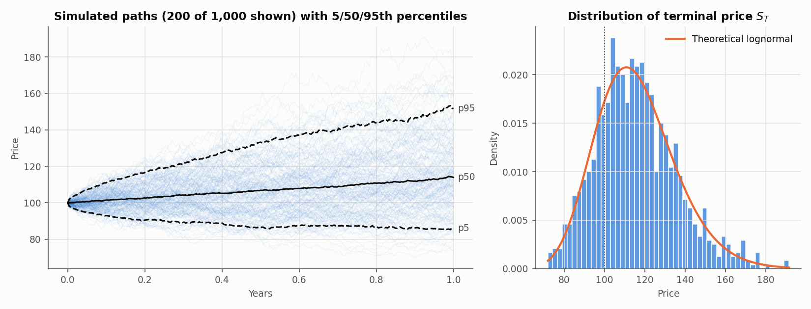
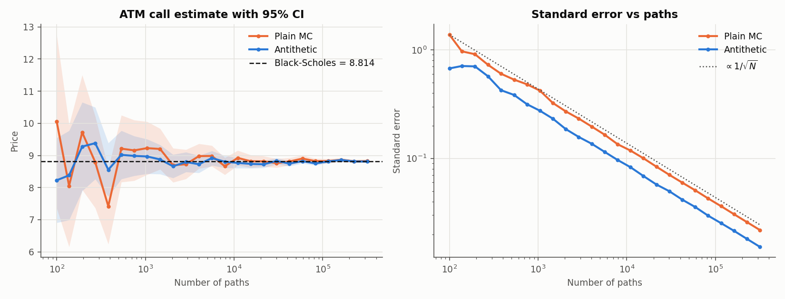
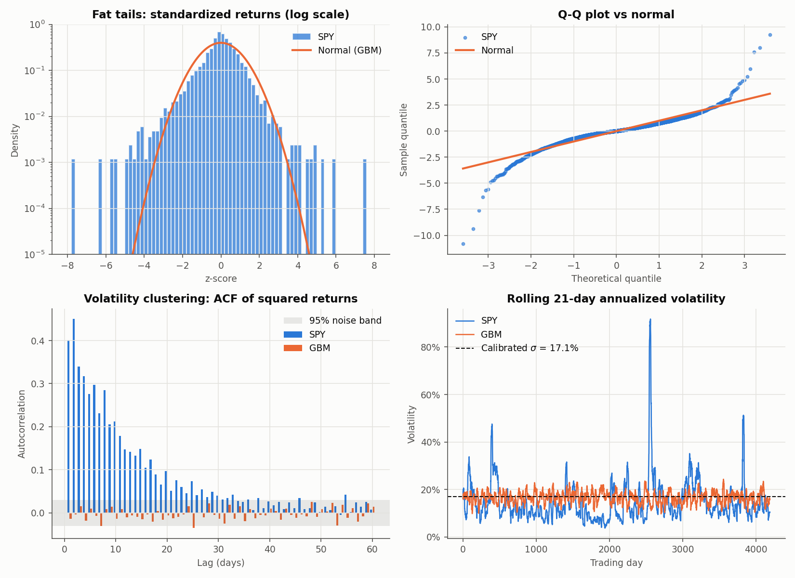

# Monte Carlo Stock Simulator

Vectorized geometric Brownian motion (GBM) in NumPy, used to price European options against
Black-Scholes, measure the speedup from antithetic variates, and then test GBM against real
S&P 500 (SPY) data to show where the model breaks.

```bash
python3 -m venv .venv && .venv/bin/pip install -r requirements.txt
.venv/bin/python run_all.py              # SPY since 2010, r = 4%
.venv/bin/python run_all.py --ticker QQQ --rate 0.045
.venv/bin/python -m pytest tests
```

## Layout

| File | Contents |
|---|---|
| `mcsim/gbm.py` | Exact log-space GBM paths and terminal prices, with optional antithetic draws |
| `mcsim/pricing.py` | Black-Scholes closed form and risk-neutral Monte Carlo with standard errors |
| `mcsim/data.py` | yfinance download with CSV cache, plus MLE calibration of μ and σ |
| `mcsim/diagnostics.py` | Kurtosis, Jarque-Bera, Ljung-Box on squared returns, tail counts |
| `run_all.py` | Runs every experiment, prints a report, and writes `figures/` |

## Results (SPY, 2010 onward, seed 42)

**Calibration.** σ = 17.1%, μ = 14.7% annualized, from 4,213 daily closes.

**1. Price paths.** 1,000 one-year daily paths. The simulated E[S_T] is 115.83 against a theoretical
115.82. P(loss) is 21%, and the one-year 95% VaR is 13.9% of the starting value.



**2. Option pricing.** Under the risk-neutral measure (drift = r), MC with 100k paths lands inside
about 1 standard error of Black-Scholes for calls and puts at strikes from 80 to 120.

**3. Variance reduction.** Antithetic variates pair each draw Z with −Z. The standard error is
computed over the independent pair averages, not the raw payoffs, because the raw payoffs in a pair
are correlated. With the same budget of payoff evaluations, the ATM call's estimator variance drops
**about 1.9×**. Both methods still converge at the 1/√N rate; antithetic lowers the constant in
front of it.



**4. Where GBM fails.** A GBM path is simulated with SPY's own μ and σ, and both go through the
same diagnostics:

| | SPY | GBM |
|---|---|---|
| Excess kurtosis | 12.4 | 0.0 |
| Skew | −0.55 | 0.0 |
| Ljung-Box on r² (20 lags, 5% critical value 31.4) | 4,756 | 15 |
| Days with \|z\| > 4 | 30 | 0.27 expected |
| Days with \|z\| > 5 | 11 | ~0 expected |

- **Fat tails.** 4σ days happen about 100× more often than a normal distribution predicts, so a
  GBM-based VaR understates crash risk.
- **Volatility clustering.** Squared returns stay autocorrelated for 30+ days. In real data,
  volatility moves through regimes; GBM holds it constant.
- **Negative skew.** Large down moves are larger than large up moves.
- **For pricing**, constant σ is the reason the market's implied volatility smile exists.
  Heston, GARCH and jump-diffusion models are the usual fixes.



## Possible extensions

- Path-dependent payoffs (Asian, barrier) where no closed form exists
- Control variates, using the geometric-average Asian option as the control
- GARCH(1,1) or Heston simulation, then re-running section 4 to show which failures each one fixes
- Greeks by pathwise and likelihood-ratio estimators
